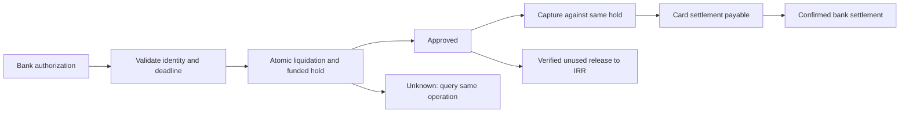

# Asset-linked Card Application Flow Design

Status: Future product design only; excluded from V1 implementation. New limits and provider semantics are proposals requiring partner approval.
[Design](DESIGN.md) | [Ledger contract](FINANCIAL_OPERATIONS.md) | [Defense](defense/D035-card-authorization-and-settlement.md)

## Boundary and funding policy

Partner bank owns card issuance, switch integration and merchant payment. Application owns authenticated bank-message handling, funding selection and lifecycle orchestration. Ledger owns shared balances, financial holds, atomic conversion and card payables.

Proposed funding order: available IRR, then eligible gold, then fund units only when an explicitly funded instant-liquidity arrangement is active. Customers must consent to auto-liquidation order, fees and limits before card activation. Otherwise decline the unsupported fallback.

A fund redemption receivable is not cash. Proposed fund fallback is a funded platform purchase of customer units into a platform-owned unit position, followed by asynchronous platform redemption. It requires real unit-transfer capability, a current approved valuation/haircut and funded capacity. If the brokerage cannot transfer ownership or the arrangement is not approved, disable Fund fallback. Do not implement customer debt/credit implicitly.

Gold liquidation is also an internal platform purchase, subject to current price validity, customer balance and free funded liquidity. No custodian/brokerage call belongs in the switch response path.

## Authorization identity and deadline

Authenticate and validate partner messages before financial processing. Use the bank's documented unique transaction identity with issuer/network namespace; a display reference alone is insufficient. Pin card token, customer, amount, currency, authorization reference and request digest. Keep PAN/security data out of ordinary logs; bank tokenization and certification remain activation requirements.

The bank supplies an actual authorization deadline D and duplicate/reversal rules. Proposed internal budget is D minus an explicit network/safety margin, validated by latency tests; no fabricated numeric SLA is claimed. Application sends an immutable ValidUntil to Ledger, which rejects new execution after its decision deadline.

Ledger operation identity is fixed before sending. Duplicate switch messages replay the same durable decision, not another hold.

## Synchronous authorization flow

1. Validate card/customer status, amount, consent and per-card limits.
2. Admit the bank request durably, including deadline and permanent OperationId.
3. Read an indicative funding plan; the final check is inside Ledger.
4. In one Ledger operation, recheck eligibility, deadline, all selected balances and liquidity; perform any approved liquidation; reserve the full card amount and physical settlement cash.
5. Persist Approved/Declined plus HoldId and bank response reference. Reply within the bank's agreed budget.

An advisory balance read cannot authorize spending. Gold and Card cannot spend the same available assets concurrently.

For IRR-only amount A: Debit CustomerRialAvailable A; Credit CustomerRialReserved A; create a represented physical cash reservation.

For gold shortfall: choose the smallest whole-mg quantity whose sale net covers the required shortfall under the approved bid/fee. Apply the SellGold financial legs and IRR reservation in the same Ledger transaction. Any net surplus remains wallet money. Recheck the full Card cash reservation and platform liquidity; fail all legs together if authorization cannot be funded.

A successful liquidation is financially final. Later unused authorization release returns IRR; it does not rebuy gold or fund units at a new price.

## Unknown authorization result

If Ledger committed but the bank reply was lost, keep the approved hold and query the same operation. Never send a second financial identity or release merely because the switch timed out.

A timeout response can be a definitive Declined only when Ledger rejection/nonexecution is established under the bank protocol. If Ledger may have approved, use the partner's technical/unknown response semantics and recovery path. A decline-looking timeout must not silently coexist with an untracked hold.

New execution is forbidden after ValidUntil, but replay of an already-approved operation remains valid. If the bank confirms it did not accept the authorization, release under the agreed final cancellation evidence. Without that evidence, retain/reconcile; do not assume a local timer fences late bank messages.

## Capture, release and settlement

States: Received, FinancialDecisionPending, AuthorizationUnknown, Authorized, PartiallyCaptured, Captured, ReversalPending, Released, PartiallySettled, Settled, Disputed, NeedsReview.

Capture references the exact HoldId and bank authorization. In a Ledger transaction, Debit CustomerRialReserved and Credit CardSettlementPayable for the captured portion. Retain physical cash coverage. Aggregate captures cannot exceed remaining authorization.

A completion message does not automatically release the remainder unless bank rules prove no further capture is possible. Handle partial captures with distinct immutable references and remaining amount/version. Reject an overcapture on the normal path and open an evidenced case; never overdraw a customer wallet.

Confirmed settlement: Debit CardSettlementPayable; Credit BankCash. Consume the matching cash reservation. Net bank batches need per-transaction allocation and separately evidenced partner fees.

Unused release: Debit CustomerRialReserved; Credit CustomerRialAvailable or Restricted. Release only the corresponding physical reservation. Capture/release races serialize; duplicate or out-of-order messages cannot consume the same portion twice.

Authorization expiry and late presentment depend on partner guarantees. If late presentment is possible, retain a separately funded tail-risk commitment or disable automatic expiry release until finality. Do not promise both unconditional timed release and guaranteed later capture.

## Reversal, refund and dispute

- Before capture: a verified final authorization reversal releases the remaining hold.
- After capture but before bank settlement: reverse the linked card payable back to customer IRR only if partner evidence extinguishes the settlement obligation; release its cash reservation.
- After settlement: record BankCardRefundReceivable against CustomerCardRefundPending, not available wallet. On real bank receipt, clear the receivable and credit Available/Restricted.
- A provisional dispute credit requires explicitly funded platform capacity and an approved separate policy. Default proposal: no provisional spendable credit.

Additional extension accounts: BankCardRefundReceivable (IRR Debit), CustomerCardRefundPending (IRR Credit), BrokerageFundUnits/PlatformFundPosition for any approved platform-owned Fund inventory. Receivables and pending refunds do not create spendable cash.

Refunds never automatically restore sold gold/units. A later customer purchase uses a new quote. Duplicate issuer reversals/refunds claim external-action identities and cannot both release and refund the same captured amount.

Atomically allocate each reversal/refund and pending refund reservation to its original capture. Cumulative customer returns plus active refund entitlements cannot exceed the eligible captured amount. Several different action IDs do not authorize several full refunds. A verified excess bank return opens a case and is recorded as unidentified/restricted evidence rather than another spendable customer credit; do not discard actual cash or erase the original capture. Match pre-settlement reversal and post-settlement refund claims so the same entitlement cannot be satisfied twice.

## Asynchronous work

After authorization, Application handles result recovery, bank capture/reversal messages, settlement batches, reconciliation and inventory replenishment. Gold procurement or platform fund redemption may happen later. Treasury funding remains operations-managed unless a separately approved future policy changes it.

Fund instant-liquidity trades transfer unit ownership into platform inventory atomically before IRR authorization. Without that transfer, the customer's unit claim remains a liability and cannot be counted as platform backing. Delayed brokerage redemption is platform exposure, bounded by an approved per-fund inventory/liquidity limit.

Future workflows may need a process manager/Saga-style orchestration; this design does not promise that every bank/broker interaction is one atomic transaction. Only Ledger financial legs are local and atomic.

## User, support and operations

Show pending card hold separately from captured/settled transactions. Show any auto-sale quantity, executed price, fee and surplus. On release say that the authorization was released to IRR, not that the original assets were restored. Unknown and disputed results remain visible with a support reference.

Monitor switch response latency, deadline misses, unknown authorization age, hold age, duplicate/conflicting messages, liquidity rejects, outstanding settlement and late presentment. Ledger outage causes technical unavailability/decline according to partner rules; no offline spending fallback is assumed.

## Reconciliation and planned acceptance cases

Compare bank authorizations, holds, captures, releases, settlement batches and refunds with Ledger in both directions. Reconcile bank cash and customer asset liquidation separately. Every discrepancy has owner, evidence and correction/closure reference.

Planned cases: duplicate authorization; same identity changed amount; concurrent Card/Gold spend; stale gold price; insufficient gold/liquidity; fund fallback disabled or exhausted; response lost after approval; deadline before first posting versus replay after expiry; capture/release race; partial/overcapture; duplicate settlement/refund; late presentment; restriction before refund; bank outage.

Activation gates: bank identity/message/authentication contract, actual response SLA, capture/expiry/reversal finality, funded liquidity limits, consent, card-security obligations, bank settlement/fees and tested recovery. Undefined partner behavior disables the affected capability rather than generating a successful authorization.
