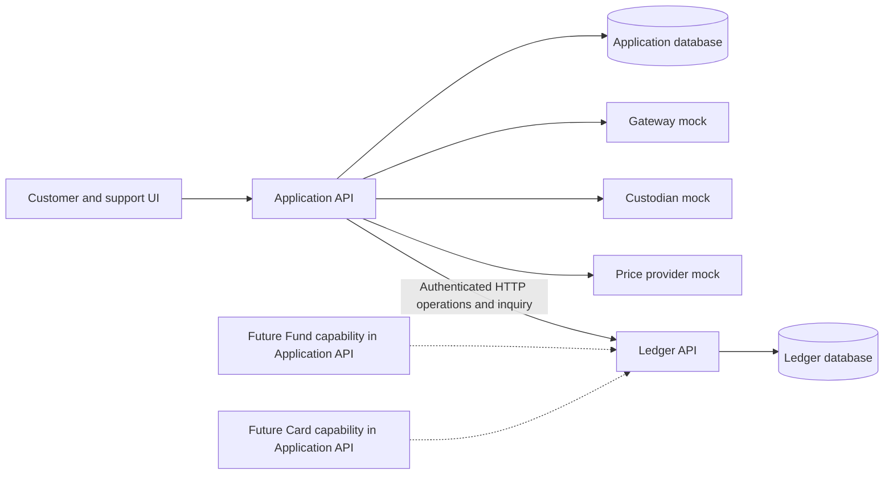
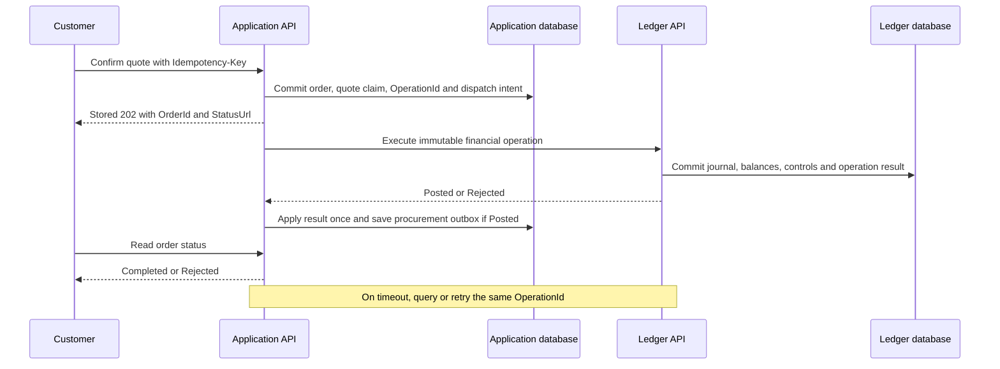

# Avand V1 - Working Design

Date: 2026-11-06
Status: Design checkpoint, not an implementation-complete or submission-complete specification.
Language: English. Audience: the candidate, two incoming engineers, and design reviewers.

This document records the design developed in the discussion. Explicitly confirmed policies are distinguished from technical proposals and unresolved questions. No application code or executable tests accompany this checkpoint.

## 1. Documents and source precedence

- [Decision log](DECISIONS.md): stable decision IDs, status and outstanding boundaries.
- [Defense guide](defense/README.md): one independent defense document for every decision.
- [Chart of accounts](CHART_OF_ACCOUNTS.md): complete draft baseline templates, balance semantics and backing/liquidity formulas.
- [Financial operations](FINANCIAL_OPERATIONS.md): complete draft typed baseline API, posting, holds, errors and recovery.
- [Posting examples](LEDGER_POSTING_EXAMPLES.md): numerical books and machine-readable accounting fixtures.
- Provided sources: Avand-Tech-Lead-Task.pdf and Avand-Questions_en.md.
- Explicit decisions in the discussion supersede earlier question-file assumptions where identified.
- The original brief remains the assignment baseline. A deliberate adaptation is not described as literal compliance.
- This checkpoint covers the baseline discussed so far. It does not incorporate the later change section of the brief.
- No email, publication, repository push, tag or deployment is authorized or performed by these documents.

## 2. Intent, constraints and scope

Build a financially correct gold-trading core that a small team can understand and extend. The initial team is the candidate, one senior frontend engineer and a designer. Keep ownership and transactions simple.

Current design scope:
- Independent rial wallet top-up.
- Quote-based gold buying and selling with fees.
- A double-entry multi-asset ledger and synchronous balance projection.
- Pooled custody, immediate customer trade finality and asynchronous platform procurement.
- Bounded uncovered gold and liquidity-gated sales.
- Operations-managed treasury and unresolved-payment review.
- Durable external-work intent, history and reconciliation.

No payment-funded buy journey, automatic resumption after top-up, automatic trade resizing, quote-time resource reservation, or automatic treasury liquidation is included.

The brief also requires withdrawal, fund/card designs, security, launch planning and operational detail. Their incomplete coverage is listed in section 16; it is not silently removed from scope.

## 3. Architecture and alternatives

Confirmed direction [D026](defense/D026-independent-ledger-service.md): deploy Ledger independently from Application API. Keep the remaining product capabilities modular inside Application API. The single-deployment proposal D019 and three-project-only layout D025 are superseded.

[PROJECT_STRUCTURE.md](PROJECT_STRUCTURE.md) describes the revised repository. [LEDGER_SERVICE.md](LEDGER_SERVICE.md) defines the proposed protocol and failure recovery.

Alternatives considered:
1. One modular application and one database transaction: smallest coordination cost, but the original folder layout gave Ledger a weak physical boundary.
2. Ledger as a separate assembly/context inside the same deployment: stronger ownership while retaining local transaction coordination.
3. Independent Ledger plus a modular Application API: selected for a common financial boundary serving Gold, future Fund and future Card. Accept the network/recovery cost and limit V1 to these two backend deployments.

Independent deployment does not automatically require a Saga framework. Financial legs remain atomic in Ledger, while Application status converges through durable operation-result recovery [D027](defense/D027-atomic-operation-and-forward-recovery.md).

| Owner | Responsibility | Prohibited shortcut |
| --- | --- | --- |
| Application Identity/Customers | Authentication mapping, customer profile and desired eligibility | Treat login or an unacknowledged profile update as authoritative financial permission |
| Application Pricing/Trading | Quotes, customer intent, orders and immutable financial requests | Directly write financial accounts or infer a timeout means no posting |
| Application Payments | Gateway verification, inquiry, credit intent and review | Credit gold or silently discard a verified late payment |
| Application Custody | External procurement and verified movement evidence | Count an in-flight purchase as physical inventory |
| Application Treasury | Manual funding workflow and commercial policy choice | Increase financial capacity by closing a request |
| Application Reconciliation/Support | Authorized evidence views, discrepancy handling and recovery actions | Edit Ledger tables |
| Ledger | Accounts, journals, balances, financial operation outcomes and atomic financial controls | Read Application tables or call providers while holding posting locks |

Two separately owned PostgreSQL databases and credentials define the data boundary. They may share one PostgreSQL instance for the exercise, so database-engine availability is still shared. There is no cross-service DbContext, SQL join or database transaction.



Future Fund and Card nodes denote planned capabilities, not extra V1 deployments. The frontend calls Application API and never holds Ledger service credentials.

### 3.1. Customer identity, ownership and eligibility

Confirmed domain separation [D023](defense/D023-customer-identity-and-ledger-ownership.md) and confirmed financial eligibility policy [D024](defense/D024-active-verified-financial-operations.md):

The business entity is Customer. Identity represents authentication; a Customer represents the person whose financial claims and operations Avand manages. Staff identities are not automatically Customers. Customer and Identity remain logical boundaries inside Application API. Ledger is a separately deployed service with its own database.

Proposed Customer shape:

```text
Customer
  Id
  IdentityUserId
  Status              // Active, Suspended, Closed
  VerificationStatus  // Pending, Verified, Rejected
  CreatedAtUtc
```

The field shape and state names are proposed. The authentication mechanism, verification provider, evidence and state-transition authorities are not yet selected. Store the stable identity association uniquely; the precise identity schema depends on that mechanism.

Customer contains no RialBalance or GoldBalance. Ledger accounts reference the stable CustomerId; their balances live in Ledger-owned AccountBalances and their financial history in JournalEntries. CustomerId is an inter-service reference, not a cross-database foreign key. Orders, payments and bank-account records reference the same CustomerId. BankAccount is a separate proposed entity for the Sheba destination, ownership and verification evidence; its provider ownership-verification and bank integration details remain to be selected; the financial withdrawal contract is defined in FINANCIAL_OPERATIONS.

Earlier uses of UserId in this checkpoint mean the internal CustomerId, not an arbitrary caller-supplied identity. UserRial and UserGold are account names, not Customer properties.

Resolve CustomerId from the authenticated principal and its trusted customer mapping. An ordinary customer request cannot select another customer by supplying an ID. Operations access uses explicit permissions and records the staff actor separately from the affected CustomerId.

The confirmed acceptance gate is:

```text
Customer.Status == Active
AND Customer.VerificationStatus == Verified
```

Apply it when accepting a new top-up, buy, sell or withdrawal. Quote issuance may check it for usability, but an old quote does not bypass financial eligibility at Ledger acceptance. The working cross-service protocol uses a monotonically versioned Ledger financial-eligibility record: a restriction is globally effective at its Ledger commit, and Application must not report it as effective before acknowledgement. Application immediately blocks new local initiation when restriction is requested. See [Ledger service section 7](LEDGER_SERVICE.md#7-quote-and-eligibility-races) for ordering and activation behavior. This replaces the earlier shared-database locking assumption.

Commit desired state, its version and control-command delivery intent together in Application. Recover by retrying the same command or reading back Ledger's effective version. Ledger saves the control update and its outcome atomically; an acknowledgement of an older version cannot mark a newer Application request effective. The same rule applies to relevant administrative financial-control updates.

This gate controls new customer instructions, not the truth of earlier financial activity. Continue verifying and accounting for a previously initiated payment after suspension or verification revocation. Do not discard a genuine late success, delete assets or reverse completed trades merely because status changed. The detailed draft credits these funds to Restricted and requires explicit approved release; this is an author proposal recorded in FINANCIAL_OPERATIONS. Recovery, reconciliation and idempotent handling of accepted operations remain possible under authorized system/operations workflows.

Proposed demo scope: seed an Active, Verified Customer and a controlled authenticated identity. A full onboarding UI is not yet committed. The fixture does not establish a production authentication or verification contract.

Planned evidence:
- Only Active plus Verified can initiate each of the four financial operations.
- A valid quote cannot authorize a new trade after eligibility is lost.
- A customer's supplied ID cannot access another customer's assets.
- A late verified payment for a suspended customer is recorded once, without permitting a new customer trade.
- Customer profile updates do not mutate ledger history or balances.

## 4. Selected stack and implementation direction

Confirmed [D018](defense/D018-dotnet-postgresql-stack.md):
- C# on .NET 10.
- PostgreSQL.

Working implementation choices:
- ASP.NET Core 10 for both backend hosts, with EF Core 10 and Npgsql 10.
- ApplicationDbContext and LedgerDbContext, in separately owned databases.
- Synchronous internal HTTP with stable, versioned DTO contracts.
- BackgroundService recovery, inquiry, procurement and reconciliation workers inside Application API.
- Application-owned durable intent/outbox records; no required message broker or Saga engine.
- Real PostgreSQL and both service boundaries in financial integration tests.
- Integer IRR and milligrams; exact integer/BigInteger intermediate arithmetic and ppm rates per FINANCIAL_OPERATIONS.

Detailed project boundaries and local execution are in [PROJECT_STRUCTURE.md](PROJECT_STRUCTURE.md). Exact package patches, PostgreSQL version, credentials mechanism and images remain to be pinned. No production throughput or completed deployment is claimed.

References:
- [EF Core transactions](https://learn.microsoft.com/en-us/ef/core/saving/transactions).
- [PostgreSQL explicit locking](https://www.postgresql.org/docs/current/explicit-locking.html).
- [Npgsql 10](https://www.npgsql.org/efcore/release-notes/10.0.html).
- [Saga coordination](https://learn.microsoft.com/en-us/azure/architecture/patterns/saga).
- [Example idempotent API contract](https://docs.stripe.com/api/idempotent_requests).

## 5. Units, quotes and fees

Confirmed [D002](defense/D002-principal-plus-fee.md), [D003](defense/D003-milligram-rounding.md), [D004](defense/D004-fee-rounding.md), [D005](defense/D005-quote-lifetime-and-feed-freshness.md):

- The rial amount entered for a buy is gold principal, excluding fee.
- Convert to whole mg by rounding weight down.
- Charge the actual principal for that rounded quantity, not the unused input remainder.
- Compute fee on that actual principal and round the fee upward to a whole IRR.
- Apply the configurable 1,000,000 to 5,000,000,000 IRR order-value range to both sides. The design checks final pre-fee principal or gross value after conversion.
- Use configurable rates of 1% on buys and 0.5% on sells, with no separate fee minimum or maximum in V1.
- The price service supplies buy and sell prices together. Buy uses the ask and sell uses the bid. Their spread is separate from the transaction fee.
- TotalDebitIRR = GoldValueIRR + FeeIRR.
- After expiry, show a new quote and require a new confirmation.
- The earlier design uses a separate 30-second feed freshness policy for new quotes. The company confirmed quote validity and did not specify a feed-freshness threshold.
- Each quote lasts 30 seconds from server issuance. Existing quotes survive a later feed outage until their own expiry.

A displayed quote does not reserve money, gold capacity or liquidity. Its displayed maximum is advisory. When the customer confirms, Application claims the quote for one durable intent; Ledger decides whether that immutable intent can financially execute before ValidUntil.

Proposed quote fields:
QuoteId, CustomerId, Side, InputMode, RequestedAmount, PriceObservationId, Price, GoldAmountMg, GoldValueIRR, FeeRate, FeeIRR, NetOrTotalIRR, IssuedAt, ExpiresAt, ConsumedByOrderId.

Use server-side time. Ledger enforces expiry at the protected first financial decision after locks, not from the browser countdown or a Application-only precheck. Successful operation replay returns the old result even after expiry. Avoid treating PostgreSQL transaction-start time as current time after a lock wait.

See [company clarifications](COMPANY_CLARIFICATIONS.md) and FINANCIAL_OPERATIONS section 2 for confirmed limits and rates, and the proposed exact arithmetic and limit-check interpretation. Existing quote economics are immutable. Source freshness and time-skew handling still need the chosen provider contract.

## 6. Pooled custody and backing capacity

Confirmed [D008](defense/D008-pooled-custody-and-immediate-trades.md), [D009](defense/D009-one-percent-backing-limit.md):

C = confirmed eligible pooled custody in mg.
U = all customer gold claims, including reserved/restricted.
G = remaining active outgoing platform-gold reservations.
Ceff = C - G.
L = floor(Ceff / 100).
UncoveredGold = max(0, U - C).
RemainingCapacity = max(0, Ceff + L - U).

Ceff is a new conservative draft extension for already-authorized physical outflows. With G = 0, it is exactly the previously confirmed formula. Unidentified physical receipts and suspense are excluded from eligible C.

During custodian unavailability, buy q is allowed only if:
max(0, U + q - Ceff) <= L.

The denominator is total confirmed custody, including gold backing customers, not only free platform stock. A pending or Unknown procurement does not increase C. Existing uncovered exposure consumes the allowance; an outage does not create a fresh allowance.

Example:
- C = 1,000 g.
- U = 995 g.
- L = 10 g.
- RemainingCapacity = 15 g.

Display:
MaxBuyGold = min(RemainingCapacity, WalletAffordableGoldIncludingFee, OrderCapGoldAtAsk).

Compute affordability with the same discrete rounding rules used for actual posting. Do not approximate away fee rounding.

OrderCapGoldAtAsk is the largest whole-mg quantity whose final buy principal fits the configured IRR order cap. If the displayed maximum is below the minimum valid order, show that no buy is currently available.

The authoritative C, U and financial guard live in Ledger; Custody supplies verified deduplicated movement evidence. Application never authorizes a buy from a separately mutable balance copy. See [financial-control authority](LEDGER_SERVICE.md#8-backing-and-liquidity-guards).

The outage 1% policy was explicitly confirmed. The detailed draft now proposes the same ceiling in healthy mode; this new default requires business review. The business authorization of temporarily uncovered holdings is assumed for the exercise and is not a regulatory conclusion.

Custody evidence must have an as-of time and include known subsequent confirmed movements. A reduction in C or corrected evidence can create a limit breach without a new buy. Stop further risk-increasing buys and escalate; do not silently reverse prior customer trades. Detailed stale-evidence and incident policies remain open.

Procurement aggregation/netting is proposed. Customer trades do not automatically map one-to-one to external trades. Incorporate accepted/in-flight requests when scheduling additional work, while distinguishing them from physically confirmed stock.

The company confirmed pooled custody, a daily CSV with total gold and daily inflows/outflows, and daily IRR settlement on business days. Define the CSV format in the mock. Execution, physical reporting and cash settlement are distinct, and one is not evidence that another completed.

## 7. Buy acceptance and cross-service recovery

Confirmed direction [D026](defense/D026-independent-ledger-service.md), [D027](defense/D027-atomic-operation-and-forward-recovery.md); detailed protocol in [LEDGER_SERVICE.md](LEDGER_SERVICE.md).

The earlier formulation that order, quote, journal and balances share one transaction is superseded. There are three local commits:

1. Application transaction A: claim Idempotency-Key, create one order, claim the quote, save the immutable financial request and permanent OperationId, save dispatch/recovery intent and the canonical admission response.
2. Ledger transaction: protect the operation identity, recheck eligibility/expiry and all balances/limits, post every financial leg and fee, update balances/controls, and save Posted or Rejected atomically.
3. Application transaction B: apply that exact result once, update order state and create any procurement intent/outbox record once.

Proposed public API behavior: POST returns a stored 202 with OrderId and StatusUrl for every replay of the same valid admitted request. It does not claim the trade has posted. GET status exposes Processing, FinancialOutcomeUnknown, Completed or Rejected.

Ledger financial finality occurs at commit. Application may briefly lag. A response loss triggers inquiry/retry with the same OperationId, not a new trade or compensation.



Ledger rechecks ValidUntil at its protected first decision; successful replay after expiry returns the original result. Application-owned quote validation alone cannot authorize a delayed financial operation.

API key and financial deduplication are distinct:
- Public key scope: customer plus operation type and request fingerprint.
- Ledger scope: authenticated ProducerId plus OperationId, with protected business references/actions.
- Changed payload under the same identity: Conflict.
- NotFound on inquiry: not proof of failure; an attempt may still be in flight.
- A terminal insufficient-balance result remains rejected after later top-up.

Keep financial amounts, policy counters and operation result inside one Ledger transaction. Do not split a trade into remote debit and credit calls. Full failure cases, retention and recovery are in the service document.

## 8. Sales and liquidity

Confirmed [D011](defense/D011-liquidity-gated-sales.md):

GrossValueIRR = actual sale principal.
NetCreditIRR = GrossValueIRR - FeeIRR.

An accepted sale immediately increases the spendable, withdrawal-eligible wallet. New customer sale acceptance also requires Active and Verified eligibility. Reject the sale if available liquidity cannot support that new obligation. No delayed-cash sale state is included.

Available liquidity is not raw bank cash. Proposed treasury model:
- Start from confirmed usable cash.
- Deduct existing customer rial claims, outstanding payout obligations, custody cash commitments and other earmarks.
- Count each obligation once. Moving a customer amount from available wallet to a withdrawal payable must not subtract it twice.
- Apply an operational buffer.
- Do not treat expected funding or a planned gold sale as cash.

CHART_OF_ACCOUNTS section 7 now defines the exact draft cash sources, obligation groups, represented versus unrepresented reservations, and separate physical-dispatch cash view. Demo buffer is zero and production values require configuration/review. Ledger owns authoritative acceptance; Treasury supplies policy and verified facts through authorized, deduplicated operations.

Inside Ledger, atomically check financial eligibility, customer gold and shared liquidity, debit customer gold, credit net IRR, post fees and update balances. The customer-gold reduction increases free platform gold but does not by itself generate bank cash.

Example concurrency test: a customer with 10 g submits two simultaneous 7 g sales. Exactly one succeeds and the remaining customer balance is 3 g. Also test two independently affordable sales that jointly exceed the platform liquidity budget.

## 9. Manual treasury

Confirmed [D012](defense/D012-manual-treasury.md):

Low liquidity creates a durable TreasuryRequest and an operations alert. Operations may arrange additional funding or sell free platform gold. No automatic custody sale occurs.

Proposed request lifecycle: Open -> InProgress -> Confirmed / Failed.
Record initiator, assigned operator, timestamps, requested amount, external references, action history and inflow evidence.

Closing a Application-side request alone does not alter cash or capacity. Submit confirmed inflow evidence through a stable Ledger operation and record the acknowledgement; only a confirmed Ledger-recorded inflow changes authoritative capacity. A treasury gold sale must also respect remaining customer-backing obligations; gold assets cannot be counted as cash while still held.

Rejected customer sales are not automatically retried after replenishment.

FINANCIAL_OPERATIONS defines the proposed reservation and evidence/approval contracts. A required configured alert threshold, response ownership and real funding arrangements remain operational setup; no production buffer or response-time claim is invented.

## 10. Independent wallet top-up

Confirmed [D001](defense/D001-wallet-only-purchases.md) and [D036](defense/D036-company-confirmed-v1-rules.md). Distributed posting follows D027.

1. Authorize new initiation for an Active/Verified customer and persist the top-up reference.
2. Receive callbacks regardless of arrival time. Treat each as notification and verify or inquire server-to-server outside database transactions.
3. Persist verified evidence and a durable Ledger credit intent using the same stable payment action identity for callbacks, inquiries and operations recovery.
4. Submit/query the Ledger operation until its outcome is known.
5. Mark the top-up Succeeded only after Ledger confirms the IRR credit. Duplicate evidence cannot create another financial operation.

Proposed states: Created, PendingVerification, VerifiedPendingLedger, Succeeded, Failed, PendingReview.

The mock gateway has a 15-minute verify window and definitively rejects verification after it expires. Record that outcome as Failed with no wallet credit. An unavailable or ambiguous provider response remains unresolved and calls for inquiry. A late callback can still identify an already verified capture. Credit verified evidence once, including after customer restriction, under the applicable bucket policy.

For an unverified payment, the company says the issuing bank handles the card return within 72 hours. Avand inquires with the gateway and shows the confirmed status and issuer-return guidance. Avand does not dispatch that return or record it as an Avand cash debit.

VerifiedPendingLedger is different: provider success is known but wallet credit is unresolved. Ledger downtime is not payment failure and does not justify an automatic refund. Track it as delivery backlog and escalate its age separately.

A successful top-up never credits gold or resumes a buy. Ambiguous verify failure is not definitive failure. A real provider failure creates no wallet credit.

FINANCIAL_OPERATIONS section 6 distinguishes unverified issuer returns from separate refund and reversal accounting for verified captures. Per-payment external-action claims prevent duplicate effects. Mapping actual provider evidence remains an adapter contract.

### 10.1 Withdrawals

The minimum is 1,000,000 IRR and the ordinary per-request ceiling is 2,000,000,000 IRR. Requests above that ceiling go to manual Finance approval and payment. Validate Sheba ownership against the customer's national ID before payment. Apply the existing Ledger authorization, funding, hold and verified-settlement controls to both routes. Specify the exact approval contract and hold timing for the manual path before implementing it.

## 11. Ledger accounts and financial operation contract

The complete draft account catalog is [CHART_OF_ACCOUNTS.md](CHART_OF_ACCOUNTS.md), the typed API is [FINANCIAL_OPERATIONS.md](FINANCIAL_OPERATIONS.md), and executable accounting-design fixtures are rendered in [LEDGER_POSTING_EXAMPLES.md](LEDGER_POSTING_EXAMPLES.md).

The catalog specifies 27 baseline templates with owner, asset, category, normal side and balance bounds. Customer claims, cash, receivables, payables, suspense and signed conversion controls are distinct. A positive credit-normal customer balance is not added to a positive debit-normal asset balance to test zero: use signed debit-minus-credit totals per asset.

The contract defines 21 financial operation types and 11 no-journal control types. It covers capture/settlement, buy/sell, withdrawals/refunds, custody, manual treasury, suspense and correction, with exact guards and response semantics. This is a proposed specification, not a claim that all templates are implemented or every new business default is approved.

Financial writer ownership stays inside Ledger. Proposed post_journal plus restricted DML and deferred validation couples entries/projections in the same transaction as operation outcome and controls. Amounts are exact units, with wide checked intermediate/aggregate arithmetic. Unexpected invariant errors roll back rather than becoming false business rejections.

Illustrative top-up of 20,000,000 IRR:
| Asset | Account | Debit | Credit |
| --- | --- | ---: | ---: |
| IRR | GatewayReceivable | 20,000,000 | 0 |
| IRR | CustomerRialAvailable | 0 | 20,000,000 |

Illustrative buy of 1,000 mg, principal 10,000,000 IRR and fee 100,000 IRR:
| Asset | Account | Debit | Credit |
| --- | --- | ---: | ---: |
| IRR | CustomerRialAvailable | 10,100,000 | 0 |
| IRR | TradingRialClearing | 0 | 10,000,000 |
| IRR | FeeRevenue | 0 | 100,000 |
| GOLD_MG | PlatformGoldPosition | 1,000 | 0 |
| GOLD_MG | CustomerGoldAvailable | 0 | 1,000 |

Illustrative sell of 500 mg, gross 4,900,000 IRR and fee 24,500 IRR:
| Asset | Account | Debit | Credit |
| --- | --- | ---: | ---: |
| IRR | TradingRialClearing | 4,900,000 | 0 |
| IRR | CustomerRialAvailable | 0 | 4,875,500 |
| IRR | FeeRevenue | 0 | 24,500 |
| GOLD_MG | CustomerGoldAvailable | 500 | 0 |
| GOLD_MG | PlatformGoldPosition | 0 | 500 |

After these three customer operations, wallet is 14,775,500 IRR and gold is 500 mg. The examples use illustrative prices, the company-confirmed fee rates and valid funding/custody. Both trades fall within the confirmed order limits.

The full numerical books also show custody funding/receipt, payout partial settlement, bank refund, provider-paid refund before merchant debit, failed payment with no capture, capture already returned before delivery, restricted late success, involuntary reversal after spending, suspense resolution and a linked correction.

## 12. Durable work, history and support

Updated [D016](defense/D016-durable-outbox-and-workers.md), separation [D017](defense/D017-separate-operation-lifecycles.md):

- Application admission and its Ledger dispatch/recovery intent commit together.
- Recovery queries/retries a permanent OperationId using the immutable saved payload.
- Ledger posts balances, journals, financial controls and its durable result in one local transaction.
- Application result application and procurement outbox commit together.
- Ledger result polling is the required V1 transport; no broker or parallel push-event path is required.
- If an integration event is later published, use the emitting owner's outbox and receiver deduplication.
- Provider execution remains independently idempotent or inquiry-driven; a local ledger identity does not deduplicate an external custodian purchase.

Support must correlate Application OrderId, PaymentId, Ledger OperationId, journal references and external request IDs. Unknown results remain visible.

| Condition | Customer message intent |
| --- | --- |
| Financial decision pending | Processing; do not promise completed ownership yet |
| Financial outcome unknown | Result is being checked; retrying the same request does not create a second trade |
| Buy completed | Show credited gold, principal, fee and total debit |
| Insufficient wallet | Explain that principal plus fee exceeds available wallet |
| Quote expired before financial acceptance | Request a new price and confirmation |
| Backing capacity unavailable | Buying is temporarily unavailable |
| Sale completed | Show gold sold, fee and net wallet credit |
| Liquidity unavailable | Selling is temporarily unavailable |
| Provider payment unresolved | Payment is under inquiry or review |
| VerifiedPendingLedger | Payment is verified; wallet credit is still being completed |

A pending procurement does not reverse an already Posted trade. An order-status update failure triggers forward repair, not a balancing reversal. Exact customer wording, support permissions and the complaint runbook remain incomplete.

## 13. Reconciliation

Retained requirement [D021](defense/D021-reconciliation-and-history.md):

Compare gateway, bank and custody evidence against Application operations and Ledger outcomes/journals retrieved through authorized APIs. Also report a Posted financial operation whose Application order is unresolved, and never treat an out-of-date Application status as proof that no posting occurred. Detect both external-only and internal-only records. Also distinguish amount mismatches, duplicate references, expected settlement timing and genuinely Unknown outcomes.

Do not repair by directly editing a balance. Record the discrepancy, supporting evidence, owner, action and linked corrective journal when one is justified.

Reconcile the company-confirmed daily custody CSV against physical gold movements and separately reconcile daily business-day IRR settlements against cash evidence. Calendar/cutoffs, tolerances, aging, escalation and closure remain open. A sample mismatch report and complaint runbook are still required.

### 13.1 Proposed mock custody CSV

Use UTF-8 CSV with one `Closing` row for the total and zero or more `Inflow` or `Outflow` rows for that business date and custody account. All quantities are integer mg. The closing row carries a provider report reference. Each movement carries its stable provider action reference. Keep the file and compare the prior closing plus inflows minus outflows with the reported closing. Deduplicate identical rows by their scoped references and investigate changed content under an existing reference.

```csv
business_date,custody_account_ref,as_of_utc,record_type,reference,quantity_mg
2026-11-06,MockCustodyA,2026-11-06T16:00:00Z,Closing,report-2026-11-06,10900
2026-11-06,MockCustodyA,2026-11-06T09:00:00Z,Inflow,receipt-001,1000
2026-11-06,MockCustodyA,2026-11-06T14:00:00Z,Outflow,release-001,100
```

With a previous closing of 10,000 mg, this report reconciles to 10,900 mg. Link confirmed movements to their original Ledger operations so importing the file cannot recognize them twice. The closing row supports reconciliation and cannot overwrite Ledger balances. Reconcile IRR settlement with separate bank evidence on the configured business calendar.

## 14. Scenario traceability

| Original scenario | Selected-model coverage | Acceptance status |
| --- | --- | --- |
| Duplicate successful callbacks credit gold once | Duplicate verified top-up credits IRR once; buys tested separately | Deliberately adapted |
| 100 buys with one Idempotency-Key | One order, identical stored 202 admission response, one eventual Ledger outcome/posting | Retained objective; response contract refined |
| Concurrent overselling | Ledger protects gold and liquidity; one of two individually valid but jointly excessive sells fails | Retained |
| Callback after quote expiry | Top-up follows gateway verify status independently. Expired trade requires a fresh quote and confirmation | Deliberately adapted |
| Missing callback resolves after inquiry | Inquiry resolves verified success or definitive rejection, including mock verify expiry. Unknown and verified Ledger backlog remain distinct | Clarified by company Q11–Q12 |
| Balanced ledger per asset | Journals and authoritative balances remain inside Ledger | Retained |
| Gateway-only and ledger-only records | Both reported, with Application/Ledger divergence also visible | Retained |

D020 records the explicit wallet-only adaptation and its evaluation risk. The new 202 contract is not a financial-success response; demonstrate the terminal result via status.

Additional planned evidence:
- Response lost after Ledger commit produces one posting and eventual correct Application status.
- Application crashes after admission or before applying a successful financial result recover safely.
- An expired new operation rejects while an already Posted operation replays after expiry.
- Same operation identity with changed amounts is rejected.
- Concurrent buys respect shared backing; sales respect shared liquidity.
- Future-product-shaped callers cannot independently spend the same wallet funds.
- Recomputed balance equals the synchronous Ledger projection after concurrent operations.
- Stale feed stops new quotes; existing valid quotes retain their original expiry.
- Fractional fees round upward; unused principal remains in the wallet.
- Buy and sell use the correct side of the paired price observation and configured fee rate. Test both order limit boundaries and fee-inclusive wallet funding.
- A callback received after the mock window is handled, but definitive expired verification creates no wallet credit or Avand refund. Replay already verified capture evidence once.
- At-ceiling withdrawal follows the ordinary route. Above-ceiling requests need manual Finance approval. Reject a national-ID/Sheba mismatch.
- Replay and reconcile the daily custody CSV separately from cash settlement evidence on business days.
- Procurement intent is created once after the financial result is applied.
- Closing a treasury request alone adds no liquidity.
- Unknown custodian execution is not blindly duplicated.
- Effective eligibility restrictions serialize with financial acceptance.
- Eligibility/control updates survive dispatch crashes and lost acknowledgement without treating older versions as effective for newer requests.
- A new OperationId cannot bypass the protected identity of a business action or already-used quote.
- Late verified top-up remains accountable during customer restriction or Ledger outage.
- Service credentials cannot access the other service's database.

No executable tests have been implemented or run.

## 15. Company clarifications

[Company clarifications](COMPANY_CLARIFICATIONS.md) records Q1–Q17 and distinguishes confirmed rules from design interpretations. D036 supersedes earlier conflicting assumptions about the order cap, gateway verification and payout routing. It preserves separate eligibility, wallet, backing and liquidity guards.

## 16. Review boundaries and remaining design work

The baseline Chart of Accounts and Financial Operations contract now have complete draft documents. Do not describe them as unspecified, and do not describe the newly proposed defaults as already user-approved or implemented.

Review the concrete author choices in FINANCIAL_OPERATIONS section 2:
- Buy principal ceiling, sell principal floor, whole IRR/g price representation and ppm encoding of confirmed rates.
- Apply the confirmed minimum and maximum to final pre-fee principal after conversion.
- Healthy-mode 1% cap and outgoing-reservation capacity extension.
- Exact cash-obligation/hold groups, zero demo buffer, configured alert threshold and the Finance approval and hold workflow for above-ceiling withdrawals.
- Restricted incoming funds and bounded dual-control correction.
- Restricted posting function/deferred validation and coarse initial lock ordering.

Implementation work still required:
- Approve/version the remaining design defaults and configure the confirmed commercial values.
- Implement SQL, migrations, roles, account provisioning, post_journal and deferred validation.
- Implement the typed API, canonical hashing, operation/evidence claims and durable control updates.
- Implement and test provider evidence adapters, partial/unknown outcomes and dispatch safety.
- Pin runtime/database/package versions, credentials, TLS, timeouts, recovery leases and observability.
- Run real two-service/PostgreSQL tests; static journal fixture validation is not application verification.

## Future product flow designs

[FUND_PRODUCT_FLOW.md](FUND_PRODUCT_FLOW.md) and [CARD_PRODUCT_FLOW.md](CARD_PRODUCT_FLOW.md) now define end-to-end proposed flows, financial transitions, unknown outcomes, user messages, reconciliation and acceptance scenarios. Fund/Card remain excluded from V1 code.

Broader brief deliverables still incomplete:
- Validate the proposed Fund/Card activation contracts with actual partners: precision, fees, calendar, funded limits and bank deadlines. Application flows are now documented; partner agreement and implementation are not claimed.
- Full authentication/key/staff-access/audit/certification design.
- Monitoring/on-call ownership and complaint runbook.
- Reconciliation report format, cutoffs, escalation and closure.
- Week-by-week 12-week plan, next hires and five major risks.
- Demo/recording plan, candidate experience, AI report and final submission artifacts.

The confirmed withdrawal limits are product requirements for this exercise. The real ownership-check provider and manual Finance workflow still need contracts. This checkpoint delivers design documents and accounting examples.
