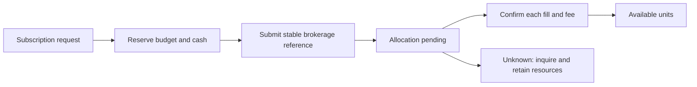

# Fund Application Flow Design

Status: Future product design only; excluded from V1 code, migrations and demo commitments. All new commercial/provider defaults are proposals for review.
[Design](DESIGN.md) | [Ledger contract](FINANCIAL_OPERATIONS.md) | [Defense](defense/D034-fund-lifecycle.md)

## Boundary and proposed policies

Application owns brokerage integration, requests, business calendar and customer presentation. Ledger owns units, pending claims, holds and cash. Use the existing Application/Ledger deployments; do not add a Fund service merely to add a product.

Subscription input is a rial budget including configured fees. Redemption input is whole minor units. Each FundId has an immutable asset definition and configured unit scale; the actual brokerage scale must be confirmed before activation. Published NAV is indicative until brokerage confirms execution. Never promise indicative units or redemption cash as final.

Use a configurable brokerage business calendar and cutoff in Asia/Tehran. Requests after cutoff roll to the next eligible processing session; no invented market cutoff or holiday list is assumed. Preserve the calendar version and processing date. Fees and allowed price/slippage tolerance are explicit customer-approved limits. If unavailable, disable submission rather than invent a rate.

## Subscription sequence

1. Check effective customer eligibility and show indicative NAV, fee policy, estimated units, cutoff/date and that allocation is pending.
2. Application durably admits an idempotent request and permanent Ledger operation identity.
3. Ledger atomically debits CustomerRialAvailable and credits CustomerFundSubscriptionPending for the full approved budget. Create a matching cash commitment; the reclassification must not create treasury headroom.
4. Application records the reservation result and HoldId. Before external dispatch, persist the stable brokerage request identity and DispatchStarted.
5. On proven brokerage cash payment, debit BrokerSubscriptionAdvance and credit BankCash; consume the corresponding cash commitment.
6. On confirmed allocation, remove the allocated pending claim against the advance and credit actual customer units against BrokerageFundUnits. Recognize the evidenced fee separately.
7. Release/refund unused budget only after the brokerage proves it is not needed and cash is available/returned. A pending receivable is not a wallet credit.

Application states: Admitted, FundsReserved, Submitted, OutcomeUnknown, AwaitingAllocation, PartiallyAllocated, Completed, CancellationPending, Cancelled, Rejected, NeedsReview. Ledger Posted and brokerage evidence drive transitions; network timeout cannot create Rejected.

Cancellation before potentially dispatched submission releases the exact claim/commitment. After dispatch, request cancellation but retain resources until definitive acknowledgement. Partial allocation is final for allocated units; cancellation applies only to the remaining request. Never undo allocated units because Application status persistence failed.

## Allocation accounting

Let allocated budget A = actual unit consideration P + customer fee F. IRR entries: Debit CustomerFundSubscriptionPending A; Credit BrokerSubscriptionAdvance P; Credit FeeRevenue F. The fee portion of the original budget must remain held locally until earned; only P is sent to brokerage. If the provider instead receives the entire budget, map its evidenced fee/remittance explicitly and do not recognize the fee twice.

Fund asset entries: Debit BrokerageFundUnits q; Credit CustomerFundAvailable q. Each fill has a unique external action reference and explicit cost/fee allocation. Sum of fills cannot exceed the authorized budget or units. Out-of-range execution is an evidenced exception case; do not silently debit additional wallet money.

When F is earned, retire that fill's locally retained fee commitment in the same Ledger transaction as allocation/fee recognition. Brokerage payment consumes only its principal commitment. Retain the unallocated budget's remaining commitment until actual payment or evidenced cancellation/return; completing a fill must neither strand fee capacity nor release the unfinished remainder.

Before allocation, the app shows reserved budget and estimated units, not tradable units. On partial fill, show actual units plus remaining pending budget. Final unit count derives from confirmed fills, never from dividing budget by yesterday's NAV.

## Redemption sequence

1. Show current units, indicative NAV, fee limits and estimated settlement date.
2. Admit one request and atomically move CustomerFundAvailable to CustomerFundReserved.
3. Submit the stable brokerage reference outside Ledger locks.
4. On confirmed redemption, debit CustomerFundReserved and credit BrokerageFundUnits. Record gross cash as BrokerRedemptionReceivable, customer net as CustomerFundRedemptionPending and fee as FeeRevenue.
5. Only on confirmed bank receipt convert receivable to BankCash and customer pending net to CustomerRialAvailable or Restricted.

For gross R and fee F: Debit BrokerRedemptionReceivable R; Credit CustomerFundRedemptionPending R-F; Credit FeeRevenue F. Receipt: Debit BankCash R; Credit BrokerRedemptionReceivable R, then Debit pending R-F; Credit customer wallet R-F. Provider-deducted fees require the matching net receipt/expense allocation and cannot be counted twice.

States: UnitsReserved, Submitted, OutcomeUnknown, PartiallyRedeemed, AwaitingCash, PartiallySettled, Completed, CancellationPending, Cancelled, Rejected, NeedsReview.

The source delay is one to two business days, not 24-48 elapsed hours. Compute an estimated due date from confirmed execution and the brokerage calendar. Missing cash after the due date creates an operations discrepancy; never manufacture cash or automatically restore already-redeemed units.

Partial redemption consumes only confirmed units. Partial cash receipt releases only the matched customer pending amount; keep the rest nonwithdrawable. Pre-execution definitive rejection releases units. Unknown execution keeps units reserved. Received funds after restriction go to Restricted.

## Recovery and concurrency

Application stores intent, immutable budget/limits, OperationIds and brokerage references before calls. Ledger retries replay the same outcome. Brokerage retries require its own idempotency/inquiry contract; Ledger deduplication cannot prevent a duplicate external subscription.

Concurrent redemption and Card unit reservation share the same Ledger available units. Capture/release serialize on HoldId. Out-of-order fills are deduplicated individually; cumulative executed/settled amounts never regress. Brokerage NotFound is not proof that an in-flight request cannot execute.

## User and support views

- Reserved: "Your budget is reserved; units have not yet been allocated."
- Unknown: "The brokerage result is being checked. Do not submit a replacement request."
- Partial: show confirmed units/cash and the unresolved remainder separately.
- AwaitingCash: "Redemption is confirmed. Proceeds are expected on [business date] and are not yet withdrawable."
- Overdue: "Settlement is delayed and is being followed up."

Support sees customer/request/hold/operation/fill/payment references, indicative versus executed NAV, fees, calendar version, due date, journals and evidence.

## Reconciliation and planned acceptance cases

Daily compare brokerage requests, executed units, custody position, allocated costs, fees and settlement cash in both directions. Separate expected settlement timing from missing records. Case closure requires evidence and a linked corrective operation, never direct balance edits.

Planned cases: duplicate submit/fill; lost acknowledgement; post-cutoff request; holiday due date; NAV movement beyond consent; partial allocation/refund; concurrent over-redemption; cancellation versus fill; partial/overdue cash; restriction before receipt; provider outage; mismatched units/cash.

Activation requires actual brokerage calendar, pricing/fill guarantees, precision, fee schedule, cancellation finality and settlement evidence contracts. This document specifies the workflow and safe fallback, not invented provider guarantees.
